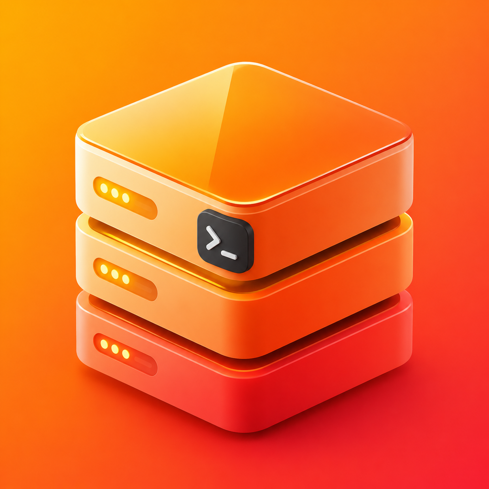
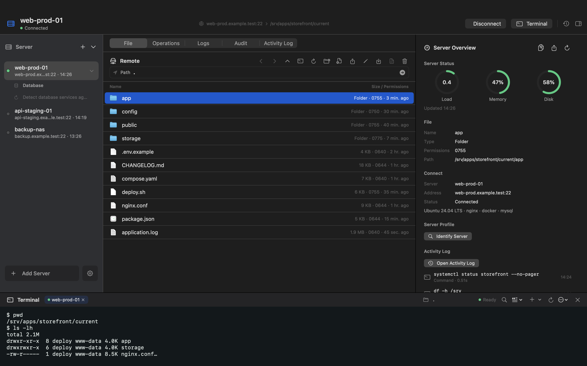

<p align="center"></p>

# OpsDeck

A native macOS SSH workspace for files, terminals, databases, and everyday server operations. Connect directly to your own servers; no server-side agent or OpsDeck account is required.

[简体中文](README.zh-CN.md) · [Mac App Store](https://apps.apple.com/app/id6792424131) · [Contributing](CONTRIBUTING.md) · [Security](SECURITY.md)



## What it does

- **Files:** browse SFTP directories, upload from Finder, download, rename, edit text, manage permissions, and review transfers.
- **Terminals:** multiple SSH PTY tabs rendered with SwiftTerm, with search and clipboard support.
- **Operations:** inspect server resources, services, logs, Docker, Nginx, packages, and scheduled tasks. Review generated execution plans before changes run.
- **Databases:** MySQL/MariaDB/PostgreSQL query workspaces and basic administration; Redis key browsing, String editing, TTL, and bounded previews of other types.
- **Local credentials:** Keychain storage, SSH host-key verification, and optional Touch ID protection.
- **Native interface:** SwiftUI and AppKit, light/dark appearance, keyboard shortcuts, and 12 locale catalogs. Some long-tail technical strings still fall back to English.

The current source enables all features. StoreKit scaffolding and a local test configuration remain for maintenance; a purchase is not required to use this version.

## Build from source

Requires macOS 15 or later and Xcode with the Metal Toolchain (install it with `xcodebuild -downloadComponent MetalToolchain` if Xcode reports it missing). The published source is verified with Xcode 27.1. Open `OpsDeck.xcodeproj`, select the **OpsDeck** scheme, and run it, or use:

```sh
git clone https://github.com/HansenCCC/OpsDeck.git
cd OpsDeck
xcodebuild -project OpsDeck.xcodeproj -scheme OpsDeck   -configuration Release -derivedDataPath build   -onlyUsePackageVersionsFromResolvedFile build
open build/Build/Products/Release/OpsDeck.app
```

The checked-in project uses ad-hoc signing and does not require the maintainer's certificate, Apple team, private repository, or configuration files. SwiftPM downloads dependencies; internet access is needed for the first build. Preserve `Package.resolved` for reproducible dependency versions.

To give a development build a separate app identity, preferences, and sandbox container, add `OPSDECK_BUNDLE_IDENTIFIER=org.example.opsdeck.dev` to the build command. The Keychain service name is shared in the source, so a different bundle identifier alone is not a guarantee of credential isolation; use a separate macOS test account for credential integration tests. Renamed redistributions should use their own bundle identifier and product identity.

Run the existing unit tests with an isolated app identity:

```sh
xcodebuild -project OpsDeck.xcodeproj -scheme OpsDeck   -configuration Debug -derivedDataPath build-tests -destination 'platform=macOS'   -parallel-testing-enabled NO -onlyUsePackageVersionsFromResolvedFile   OPSDECK_BUNDLE_IDENTIFIER=org.example.opsdeck.tests-host test
```

After adding source files or resources, install the `xcodeproj` Ruby gem (`bundle install` with the included Gemfile), then run `bundle exec ruby gen_project.rb`. Regeneration preserves the dependency lockfile and includes third-party notices in the application bundle.

## Privacy and connections

Server profiles and operation history are stored locally; credentials use the macOS Keychain. OpsDeck connects to the SSH servers you configure. App Store version checks contact Apple's lookup API. Approved package/deployment operations can cause your remote server to download software from upstream services. This is not an offline-only application.

Remote writes and commands affect your servers. Inspect the target and execution plan before confirming; use a disposable test environment when developing changes. Never attach real private keys, passwords, server inventories, or unredacted logs to issues.

## Scope and limitations

OpsDeck focuses on individual-server workflows. It is not a fleet orchestrator or a full hosting control panel. Database support is intentionally narrower than specialist database tools. Cancelling a plan cannot undo commands that already completed. Touch ID needs a supported Mac with enrolled fingerprints.

The screenshot uses fictional hostnames and demonstration data rendered by the native app views. It is not a live production server capture.

## License

OpsDeck's own code is available under the [MIT License](LICENSE). Third-party components retain their own licenses; see [Third-party notices](THIRD_PARTY_NOTICES.md). The license does not grant rights to impersonate the official OpsDeck product or its maintainer.
