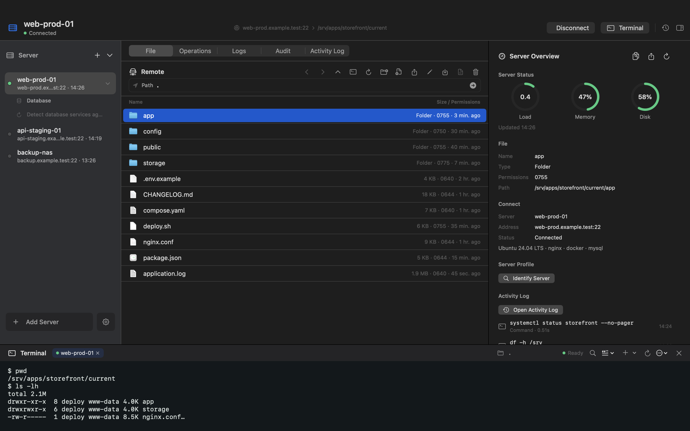

# OpsDeck

原生 macOS SSH 工作台，把远端文件、终端、数据库和日常服务器运维放在一个应用里。直接连接自己的服务器，无需服务端 Agent，也无需 OpsDeck 账号。

[English](README.md) · [Mac App Store](https://apps.apple.com/app/id6792424131) · [参与贡献](CONTRIBUTING.md)



## 功能

- SFTP 文件浏览、Finder 上传、下载、重命名、文本编辑、权限管理与传输记录。
- SwiftTerm 渲染的多标签 SSH PTY 终端，支持搜索与剪贴板。
- 服务器状态、服务、日志、Docker、Nginx、软件包、Cron；变更执行前可审阅命令计划。
- MySQL / MariaDB / PostgreSQL 查询与基础管理；Redis 键浏览、String 编辑、TTL 与其他类型的有限只读预览。
- Keychain 凭据存储、SSH Host Key 校验、可选 Touch ID 保护。
- SwiftUI / AppKit 原生界面、深浅色主题、快捷键及 12 种语言目录；部分长尾技术文案仍回退英文。

当前源码版本所有功能默认开放，不要求购买。保留 StoreKit 代码及本地测试配置，供后续维护。

## 独立构建

需要 macOS 15+、Xcode 及 Metal Toolchain（若提示缺少组件，执行 `xcodebuild -downloadComponent MetalToolchain`）。公开源码使用 Xcode 27.1 验证。可以直接打开 `OpsDeck.xcodeproj` 运行 OpsDeck scheme，或执行：

```sh
git clone https://github.com/HansenCCC/OpsDeck.git
cd OpsDeck
xcodebuild -project OpsDeck.xcodeproj -scheme OpsDeck   -configuration Release -derivedDataPath build   -onlyUsePackageVersionsFromResolvedFile build
open build/Build/Products/Release/OpsDeck.app
```

默认 ad-hoc 签名，不依赖维护者证书、Apple Team、私有仓库或私有配置。首次构建需要联网获取 SwiftPM 依赖，保留 `Package.resolved` 中锁定的版本。

如已安装正式 OpsDeck，开发构建建议追加 `OPSDECK_BUNDLE_IDENTIFIER=org.example.opsdeck.dev`，以区分应用身份、偏好与沙盒容器。源码中的 Keychain service 名称仍固定，因此不同 bundle ID 不等于凭据完全隔离；凭据集成测试请使用独立的 macOS 测试账号。测试命令和工程重生成方式见 [英文说明](README.md#build-from-source)。

## 数据与边界

服务器配置和操作记录保存在本机，凭据存入 Keychain。应用会连接用户配置的 SSH 服务器，并访问 Apple 接口检查 App Store 版本；用户批准的软件安装或部署会让远端服务器访问相应上游服务，因此不能将本地存储理解为完全不联网。

远端命令和写操作会真实影响服务器，执行前请核对目标与计划。开发验证使用可丢弃的测试环境，不在公开 issue 中附带真实密码、私钥、服务器清单或未脱敏日志。

目前主要面向单服务器工作流；数据库能力为轻量基础管理，不提供完整集群编排。取消执行不能撤销已完成命令。Touch ID 需要支持且已录入指纹的 Mac。截图来自原生视图与虚构演示数据。

## 许可证

OpsDeck 自有代码采用 [MIT](LICENSE)。第三方依赖仍遵守各自许可证，见 [第三方声明](THIRD_PARTY_NOTICES.md)。开源许可不授予冒充官方产品或维护者的权利。
